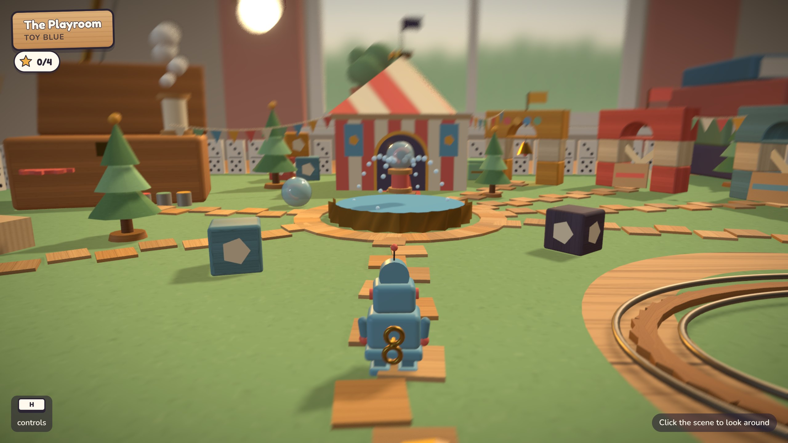
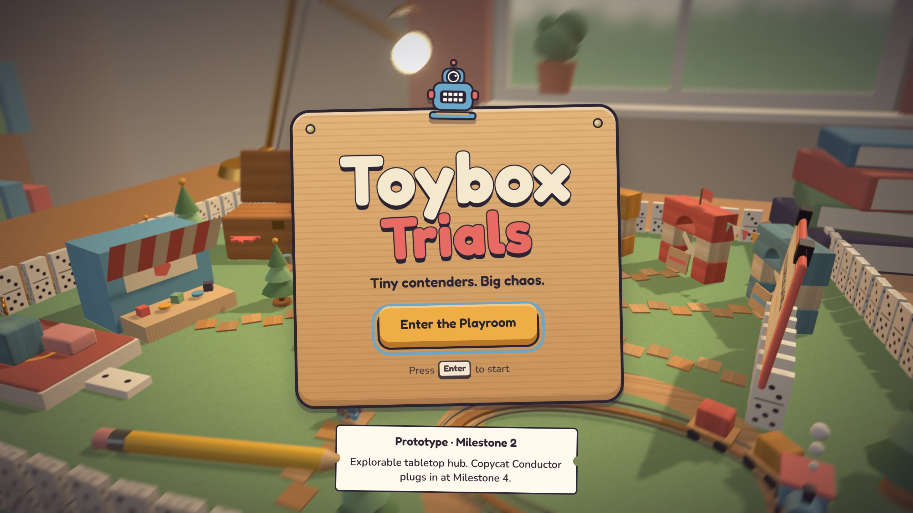
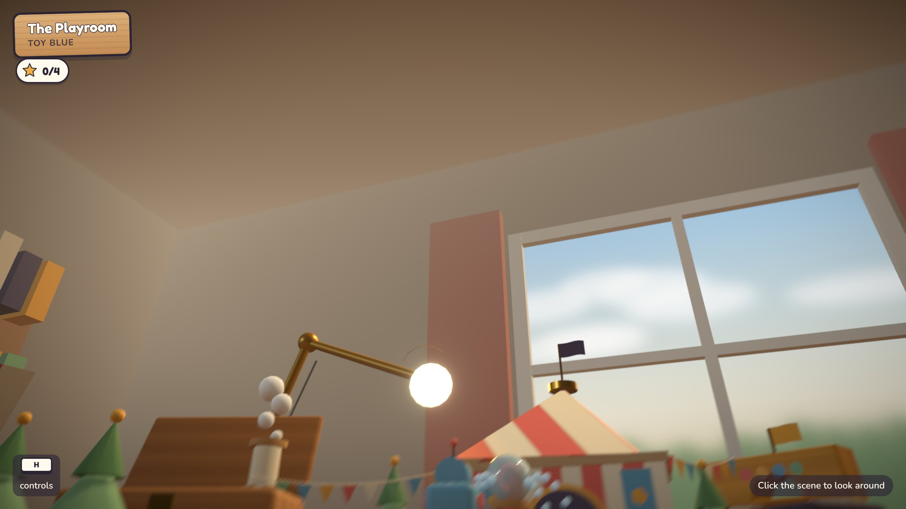
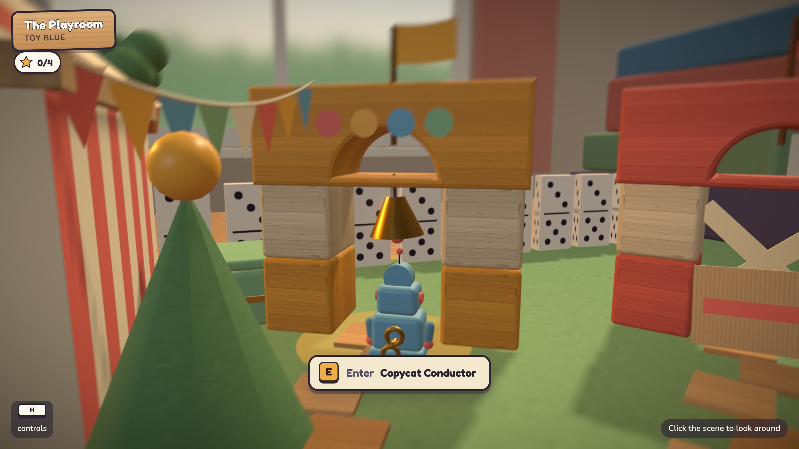
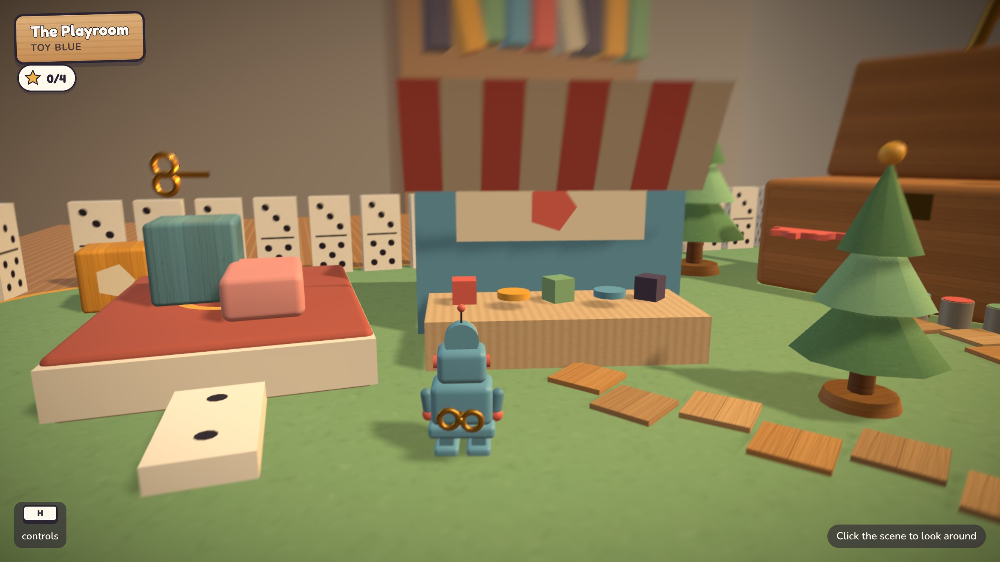

# Toybox Trials: The Living Playroom

**Tiny contenders. Big chaos.**

▶ **Play the prototype:** https://toybox-trials.vercel.app (desktop or phone; auto-deploys from `main`)

When the humans leave the room, the toys come alive and hold a tournament on the tabletop.
This repository contains **Milestones 1–2**: the art-direction package and a small, genuinely
explorable 3D toy-world prototype.



> **Status:** prototype hub + main menu + Workshop (Milestones 1–3). This repository is the canonical
> game. The earlier Base44 version is not being ported.

## Run it locally

Requires **Node 20+** (tested with Node 22).

```bash
npm install
```

```bash
npm run dev
```

Open the printed URL (default http://localhost:5173). For a production build:

```bash
npm run build
```

```bash
npm run preview
```

The build output in `dist/` is a static folder with relative paths. Host it anywhere.

## Controls

| Input | Action |
| --- | --- |
| **W A S D** / arrows | Move (camera-relative) |
| **Shift** | Run |
| **Space** | Jump (hop onto blocks, books, the domino step…) |
| **E** | Interact with the prompted object |
| **Mouse** | Click the scene to capture the mouse and look around (or drag) |
| **Esc** / **P** | Pause and settings (volume, quality, mouse sensitivity, invert Y, FPS meter) |
| **H** | Show/hide the controls card |
| **Enter** / **T** | Online Hub: open the chat box (Enter sends, Esc closes). While an interaction prompt is showing, Enter interacts as before |

**On phones and tablets** (works in both portrait and landscape):
- Put your left thumb anywhere on the lower-left to bring up the joystick. Push it to the rim to run.
- Drag anywhere else to look around.
- Tap **Jump**, or the red action button that appears next to things. You can also tap the prompt itself.
- The gear button pauses.
- In the online Hub, the **Chat** button opens the chat sheet (the log, the People list for muting, and a text box that stays above the on-screen keyboard).

Things to find in the Playroom:
- **Copycat Conductor gate** (honey arch): play Copycat Conductor solo or against bots.
- **Jack-in-the-Box gate** (coral arch): a hot-potato word game against 1–7 bots. Each round has a category ("Name a fruit"). Type an answer nobody has said yet to crank the box and pass it on. When the jack pops, whoever is holding it is out.
- **Tournament Pavilion** (striped tent): run a Blitz (3), Normal (5) or Treasure (8) tournament against bots, or practise any single trial, including **Find the Original** (spot the real Baldwyn in a crowd of look-alikes). Blitz is three quick party trials; Normal and Treasure play party trials and finish with one strategy game (Toy Squad, Toybox Siege or Toy Tower Tumble). The practice list is folded into Party games and Strategy games.
- **Workshop** (pencil case): opens the Workshop screen. Name your contender and pick a paint job, hat and key skin. Secrets unlock extra items.
- **Scoreboard** (domino wall): tracks secrets.
- **Four hidden secrets.** Look behind the pavilion, near the fountain, behind the workshop, and on top of the book tower (jump: domino → book → eraser → block).
- **Online Hub** (see [`docs/ONLINE.md`](docs/ONLINE.md)): walk around with other players, wave, kick the shared marble, shoot hoops, host lobbies, and **chat** (text, with a word filter, per-player mute and a Text chat switch in Settings).
- **Who Am I?** (online Hub only): open the suspicious box and the jack slaps a paper card on your toy's face. Everyone else can read it; you can't. Ask the others, then guess the everyday thing (an animal, a job, a food or an object) in chat. Guess right and it falls off with confetti (and a few cogs, at most three times an hour); or peel it off to give up. Offline the box springs its old ambush.

## What's in the box

| Deliverable | Where |
| --- | --- |
| **Master game design (spec)** | [`GAME_DESIGN.md`](GAME_DESIGN.md) |
| **Development roadmap** | [`DEVELOPMENT_ROADMAP.md`](DEVELOPMENT_ROADMAP.md) |
| 1. Repository architecture audit | [`docs/01-architecture-audit.md`](docs/01-architecture-audit.md) |
| 2. Technical implementation plan | [`docs/02-technical-plan.md`](docs/02-technical-plan.md) |
| 3. Visual design guide | [`docs/03-visual-design-guide.md`](docs/03-visual-design-guide.md) |
| 4. Concept art (2 generated) + prompts for the rest | [`docs/04-concept-art-prompts.md`](docs/04-concept-art-prompts.md), `public/assets/concepts/` |
| 5. Explorable 3D prototype | `src/` (run with `npm run dev`) |
| 6. Run instructions | this file |
| 7. Known limitations & performance risks | [`docs/05-known-limitations.md`](docs/05-known-limitations.md) |
| Room dog model brief (Meshy/Tripo) | [`docs/06-room-dog-asset-brief.md`](docs/06-room-dog-asset-brief.md) |
| Asset manifest | [`public/assets/asset-manifest.json`](public/assets/asset-manifest.json) |
| Character construction sheet | [`docs/assets/contender-blueprint.svg`](docs/assets/contender-blueprint.svg) |

## Tech

React 19 · TypeScript · Vite 8 · three.js · React Three Fiber · drei · postprocessing · Zustand ·
Web Audio. There is no backend and no physics engine. Every model, texture and sound is generated in code.

Quality tiers (pause menu): **Low** (no shadows or post-processing), **Balanced** (soft shadows plus
tilt-shift), **High** (2K shadows plus true depth of field).

## Tests

Automated browser checks use Playwright (install it once with `npm i -D playwright` and
`npx playwright install chromium` if you don't already have it). Start the preview server first:

```bash
npm run build && npm run preview -- --port 4173
```

```bash
node tests/e2e/functional.cjs
```

```bash
node tests/e2e/secrets.cjs
```

```bash
node tests/e2e/mobile.cjs
```

```bash
node tests/e2e/menu.cjs
```

```bash
node tests/e2e/minigame.cjs
```

```bash
node tests/e2e/rhythm.cjs   # Music Box Rhythm (uses a preview server on port 4178)
```

Unit tests for the game logic (no browser needed):

```bash
npm test
```

Deep links: add `#play` to the URL to skip the menu, or `#workshop` to open the Workshop.

`?debug` in the URL exposes test hooks (`window.__toybox.teleport/aim/state/renderInfo`). Gameplay never uses them.

Verified in headless Chromium: movement, pavilion collision, play-area bounds, jumping,
standable surfaces, interaction prompts, Copycat Conductor and Jack-in-the-Box (typed answers, rejects, passing, results), mixed-game tournaments, pause and resume, repainting,
elimination and respawn, all four secrets, the speed boost, and persistence across reloads. On an emulated phone it also checked the touch
joystick, two-thumb move and look, the Jump and Interact buttons, the tappable prompt, the pause button, and portrait FOV. There were no
console errors. **Frame rate has not been measured on real hardware** (the CI container has no GPU).

## Version control

Rollback points are published as **branches** on GitHub (and exist as tags in local clones made from this history):

- `rollback/m0-scaffold`: empty scaffold before any game code
- `milestone/m2-prototype`: this prototype

To roll back, check out the branch: `git checkout rollback/m0-scaffold`.

## Screenshots

| | |
| --- | --- |
|  |  |
|  |  |

All characters, environments, code, audio and artwork are original. Reference games named in the brief
describe design qualities only.
