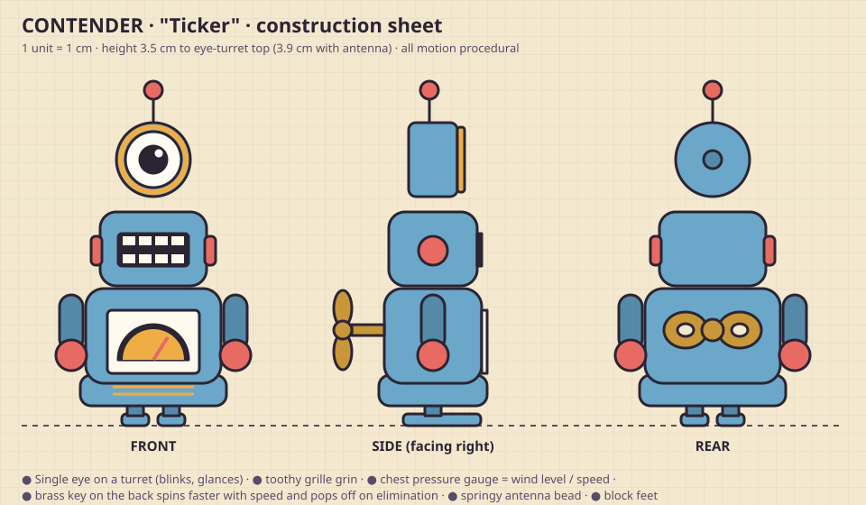

# 03 · Visual design guide: "The Living Playroom"

> **Toybox Trials** · *Tiny contenders. Big chaos.*
> When the humans leave, the toys hold a tournament on the table top, in a town they built
> from whatever got left behind.

## 1. Pillars

1. **Two scales, one world.** The *toy scale* is chunky, painted, tactile, sharp and interactive. The
   *room scale* is huge, realistic-leaning, muted and softly out of focus. Never mix them up:
   room objects are never interactive, and toy objects are never photoreal.
2. **Readable first.** Characters and interactive objects must pop against the scenery through
   saturation, rim light and silhouette. Scenery is lower in contrast.
3. **Built, not bought.** Every toy structure is made from a recognisable household object (pencil
   case, matchbox, bottle cap, thread spool, dominoes, books). If you can't name the object it's built
   from, redesign it.
4. **Charming, slightly mischievous.** Jack-in-the-boxes that ambush you, dominoes waiting to topple.
   Playful, not babyish.

## 2. Scale rules (enforced in code: 1 unit = 1 cm)

| Object | Real size | Reads to a toy as |
| --- | --- | --- |
| Contender (mascot) | 3.5 cm tall | — |
| Wooden block | 3 cm cube | a house-sized crate |
| Domino (standing) | 4.8 × 2.4 × 0.75 cm | a garden wall |
| Pencil (lying) | 18 cm × 1.5 cm | a fallen tree trunk (must jump it) |
| Hardback book | 2 cm thick | a cliff ledge |
| Mug | 11 cm tall | a tower block |
| Desk lamp | ~45 cm reach | a lighthouse |
| Table edge | 75 cm drop | a precipice |

The camera boom is 14 cm and the eye height about 7 cm, so the world is always seen from *toy height*.
Never pull the camera up to human eye level in gameplay.

## 3. Palette

| Token | Hex | Role |
| --- | --- | --- |
| Warm cream | `#F4E8CE` | UI paper, toy highlights, teeth/eyes |
| Honey yellow | `#EFAE45` | Primary action, lamp light, rewards, Copycat accent |
| Coral | `#E76B62` | Danger/excitement, pavilion stripes, Inferno accent |
| Toy blue | `#6BA7C8` | Default contender paint, water, Dash accent |
| Sage green | `#89B78A` | Felt ground, trees, calm |
| Ink purple | `#574D69` | Shadows, outlines in UI, night |
| *Supporting* | wood `#C8925A`, cardboard `#C9A57A`, felt `#7FA878`, brass `#C8973A`, ink `#2B2433` | Materials |
| *Room* | `ROOM` in `src/game/palette.ts`: wall `#DCCBB4`, panelling `#86A39C`, floor `#8A6A4E`, sofa `#7C8FA6` … | Deliberately desaturated |

Rules: at most **two** palette accents per object. Characters use the most saturated values in
frame. The room stays below 60 % saturation.

## 4. Materials

| Material | Treatment |
| --- | --- |
| Painted wood (blocks, arches) | Light grain texture tinted by paint colour; bevelled edges (8 % radius) |
| Plastic/tin (characters) | Smooth, roughness 0.4, slight rounded bevels, no texture; brass parts metallic |
| Felt (ground, trees, banners) | Fibre-speckle texture, roughness 1.0, never shiny |
| Cardboard (signs, walls) | Corrugation stripes + specks, roughness 0.95 |
| Glass (marbles) | Clearcoat, ~80 % opacity, coloured swirl inside |
| Room surfaces | Matte, larger texture scale, softened by fog + blur |

## 5. Lighting & atmosphere

One light story on every tier: **late-afternoon sun comes in through the big window in the back
wall and lands on the table**. The village sits in that sun patch; the rest of the room is lit by
what bounces around. `SUN_DIR` and `WINDOW` in `src/scene/room/bake.ts` are the single source of
truth for where the light comes from.

- **Key (toy layer, real time):** a warm directional sun (`#FFDDAE`) along `SUN_DIR`, about 31°
  above the horizon, raking toward the usual camera so toys get long shadows and a rim of light.
  On Balanced and High it casts shadow maps from a **fixed** frustum fitted to the whole table (no
  shadow swimming as the player moves). The thick window wall, the glazing bars and the drapes are
  shadow casters, so the sun patch on the table has real edges and a glazing-bar cross.
- **Practical:** the desk-lamp spotlight (honey) pooling over the square, the "heart" of the hub.
- **Fill:** warm hemisphere plus a soft cool fill from the room side, so sun-backlit faces stay readable.
- **Room layer (baked):** the room is static, so its light is computed once on the CPU into vertex
  colours (`bake.ts`): sky light from the window, direct sun where a point lies in the beam, warm
  bounce off the sunlit table, hemisphere ambient, and darkening toward corners, the floor and
  under the table. It renders with unlit materials: the cheapest possible, and the same on every tier.
- **Window:** an over-bright garden backdrop behind the glass, a soft additive halo (stands in for
  bloom on Low), additive **light shafts** (sheets lying along the sun direction that fade near the
  camera, edge-on and above the table) and dust drifting in the beam (Balanced/High).
- **Reflections:** a local, generated environment map (no downloaded HDRs).
- **Depth:** fog from 140 to 560 cm softens the room. Balanced uses a tilt-shift band focused on
  the toy's screen height. High uses true depth of field focused on the toy.
- **Grade:** ACES filmic tone mapping on every tier (renderer tone mapping on Low; a tone-mapping
  pass at the end of the post chain on Balanced/High), mild bloom and vignette on Balanced/High.
- **Contact:** shadow maps plus a soft blob shadow under the character. Blob shadows alone on Low.

| | Low (default on touch) | Balanced | High |
| --- | --- | --- | --- |
| Sun shadow map | none | 2048 × 1024 | 4096 × 2048 |
| Post | none | tilt-shift, bloom, vignette, ACES | depth of field, bloom, vignette, ACES |
| Light shafts | 3 sheets | 9 sheets | 9 sheets |
| Beam dust / drape sway | off | on | on |
| Room clutter (books, radiator, pennants…) | simplified | full | full |

Rules for adding to the room: build it with the `Builder` in `bake.ts` so it merges into the
existing draw calls and picks up the baked light; no colliders; nothing coplanar with a wall (trim
straddles the wall plane); keep the floor strip in front of the table clear for the dog (doc 07).

## 6. Camera language

- **Hub:** third-person, behind and slightly above, with the horizon in the upper third so the room is
  always visible. Pitching down past the default flips into a worm's-eye view looking up at the room.
- **Minigames:** fixed or gently elevated three-quarter views (e.g. Copycat: stage centred, all
  four instruments visible, no orbiting during sequence playback).
- **Main menu:** a low, slowly drifting shot of the contender facing camera, with the village and room behind
  (concept 01). In landscape the menu sits on the left and the toy on the right. In portrait the toy is on top and the menu below.
- **Workshop:** a close turntable orbit at 7–10 cm. The toy sits left of the panel (landscape) or above it (portrait).
- **Screen transitions** orbit or cut. They never sweep through the toy or scenery.

## 7. Character system: "Contenders"

- **Body plan:** blocky, rounded tin-plastic robot. Belt skirt, chest plate with a **pressure gauge**
  (the needle shows how wound-up the toy is, i.e. speed), toothy grille grin, **single eye** on a turret, springy antenna,
  stubby arms with ball hands, block feet, and a **brass wind-up key** on the back (it always turns, and turns faster when running).
- **Silhouette test:** must read at 40 px tall in solid black (turret plus key plus block feet).
- **Paint jobs:** body, trim and accent colours from the palette (5 shipped: Toy Blue, Coral Clank,
  Sage Sprocket, Honey Hustle, Midnight Tin).
- **Accessories:** hats on the turret top (thimble helmet, bottle-cap crown, paper-boat hat, acorn
  cap) and key skins on the back (classic, heart, star, golden) are implemented. Button badges on the chest come next.
  Each hat is a recognisable household object, so it follows the "built, not bought" pillar.
- **Motion (procedural):**
  - Idle: breathing bob and glances.
  - Walk/run: hop-step bob, waddle roll and arm swing.
  - Turning: lean into the turn while the head leads.
  - Jump: stretch on the way up, a damped squash spring on landing.
  - Interact: a happy hop with a wave and squinting eye.
  - Elimination: spring compress, then sproing, spin and topple onto its back. The eye becomes an X and the key pops off.
  - Respawn: an overshoot pop-in.

## 8. Interface language

UI is made of physical things from the playroom:

| UI need | Physical metaphor |
| --- | --- |
| Logo / location sign | Nailed wooden sign |
| Primary buttons | Chunky two-layer toy buttons that depress |
| Panels / menus | Cardboard with masking tape |
| Toasts | Perforated paper tickets |
| Score displays | Felt-backed boards |
| Key prompts | Sticker keycaps |
| Achievements | Star stickers |

Typography: **Fredoka** (display, rounded) and **Nunito** (body). Both are open-font-licensed and self-hosted.
Contrast: all gameplay-critical text is ink `#2B2433` on cream or paper, which meets WCAG AA or better.
Reduced motion: every CSS animation is disabled under `prefers-reduced-motion`.

**Touch UI (phones and tablets).** On-screen controls are toy parts too:
- the joystick is a felt pad with a turned-wood knob
- action buttons are chunky painted pushers that physically depress
- the pause button is a cream tile with a gear

Rules for touch:
- targets of at least 56 px
- primary actions within reach of the right thumb
- movement on the left thumb
- everything inside the safe-area insets
- nothing that works only on hover
- every key prompt has a touch equivalent (sticker keycaps become tappable pills or buttons)

## 9. Audio identity

Tactile and mechanical. Everything is synthesised (`src/game/audio.ts`):

- Footsteps: a plastic tap with a clockwork tick.
- Jump: a rising spring. Land: a wooden thud.
- UI: wooden clicks and a soft tine on prompts.
- Workshop: a ratchet wind-up.
- Reward: a music-box arpeggio with a bell.
- Elimination: a wobbling spring, a downward slide and a tin clatter.
- **Copycat voices:** A = membrane drum, S = inharmonic bell, J = woody xylophone bar, K = music-box tine.

## 10. Do / Don't

| Do | Don't |
| --- | --- |
| Name the household object behind every structure | Use generic fantasy castles or trees |
| Keep toys saturated and the room muted | Light the room brighter than the toys |
| Chunky bevels, few big shapes | Thin details, greebles, noisy textures |
| Physical UI metaphors | Flat SaaS cards, gradients, emoji, icon packs |
| Toy-height camera | Human-eye-level camera in gameplay |
| Original characters and audio | Recreate characters, levels or sounds from reference games |

## 11. Reference material from the creative director

The following references were supplied and inform these rules. They are not reproduced in the repo.
- *Wooden train set on a bedroom floor*: tracks, felt islands, cardboard tunnels, depth through bed, desk and window.
- *Blue wind-up robot toy*: basis for the contender's body plan (single eye, gauge, side/rear key).
  Our model is an original design: different proportions, grille and turret details, and a rear key.
- *Toy soldier on a red book in a magenta-lit room*: camera height, book-as-stage scale, depth of
  field. We keep a warmer palette than that reference.
